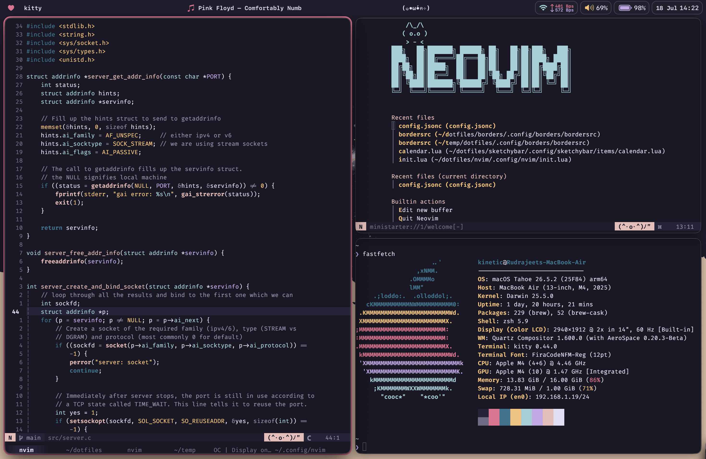

# Dotfiles

Personal macOS dotfiles managed with GNU Stow.



## Configurations

| Package | Configuration |
| --- | --- |
| `aerospace` | AeroSpace window management, including Finder scripts |
| `borders` | JankyBorders window borders |
| `fastfetch` | Fastfetch system information display |
| `git` | Global Git ignore rules |
| `kitty` | Kitty terminal, Rosé Pine theme, and additional themes |
| `nvim` | Neovim configuration, plugins, language support, and snippets |
| `rift` | Rift window management, workspaces, and Finder helper |
| `sketchybar` | Lua-based SketchyBar configuration and widgets |

AeroSpace and Rift are alternative window managers; choose the one you use.

## Installation

Install Git, GNU Stow, and the applications whose configurations you want to use. With Homebrew, Git and Stow can be installed with:

```sh
brew install git stow
```

Clone the repository and its Kitty themes submodule:

```sh
git clone --recurse-submodules git@github.com:KineticTactic/dotfiles.git ~/dotfiles
cd ~/dotfiles
```

For an existing clone, initialize the submodule with `git submodule update --init --recursive`.

Back up any existing configurations that would conflict, then stow the packages you want into your home directory. For example:

```sh
stow -t ~ nvim git kitty fastfetch
stow -t ~ aerospace borders sketchybar
# Or use Rift instead of AeroSpace:
stow -t ~ rift
```

To install every configuration, explicitly list the packages:

```sh
stow -t ~ aerospace borders fastfetch git kitty nvim rift sketchybar
```

## Setup notes

- Kitty uses FiraCode Nerd Font Mono and the included Rosé Pine theme.
- SketchyBar uses the `sketchybar` Lua module, SF Pro and SF Mono fonts, and builds its helper programs with `make` when started. Install the Lua module and a C build toolchain for the bar to work.
- The Rift configuration references `/Users/kinetic/.config/rift/open-finder-if-needed.sh`; update that path for another user account.
- Neovim installs its configured plugins on startup. Language servers, formatters, and other external tools may need to be installed separately.

